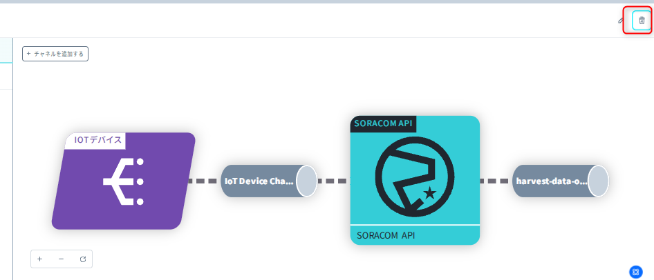
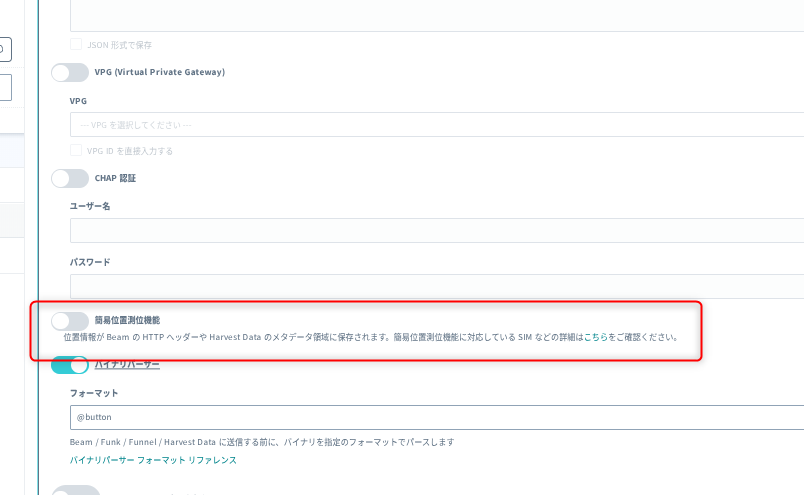
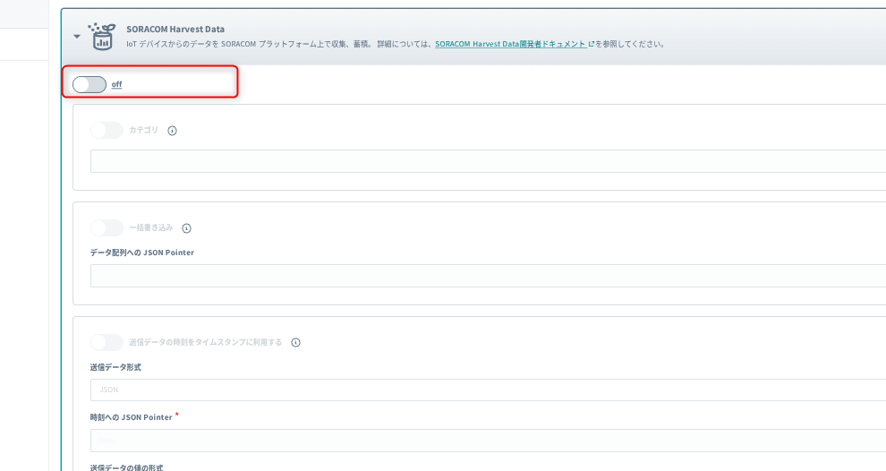

# 4. 後片付け

ハンズオン終了後、不要な費用が発生しないように以下を見直しましょう。

- Flux アプリの無効化または削除
  
- 自分の SIM グループの簡易位置測位機能・Harvest Data の OFF
  
  

---

[← 3. SORACOM Flux アプリを作成して動かす](./03-flux-app.md) ｜ [目次](./README.md) ｜ [参考リンク →](./05-references.md)
